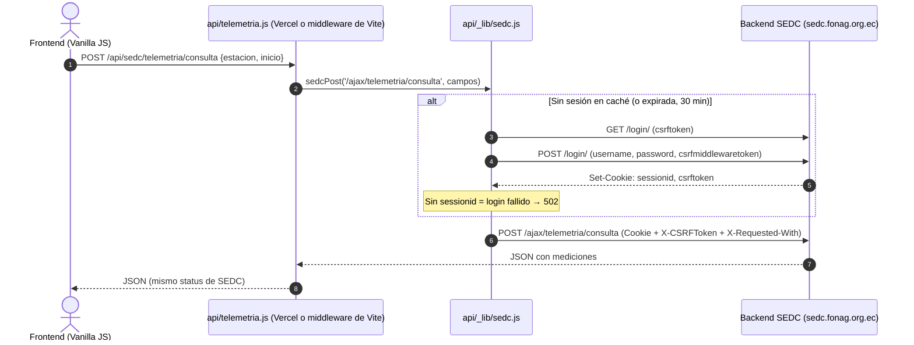

# Arquitectura Técnica y Especificación de Ingeniería: FONAG SEDC

Documentación arquitectónica detallada y minuciosa para desarrolladores sobre la modernización de la plataforma web del **SEDC (Sistema de Estandarización de Datos Crudos Hidroclimáticos del FONAG - Fondo para la Protección del Agua)**.

---

## 1. Visión General y Principios Arquitectónicos

La aplicación se diseñó como un **Portal Web de Alto Rendimiento y Cero Dependencias Ruidosas**, concebido para servir como la interfaz oficial de consulta hidroclimática, telemetría y anuarios estadísticos de las cuencas que abastecen de agua al Distrito Metropolitano de Quito (DMQ).

### 1.1. Principios Fundamentales
1. **Concepts > Code**: Separación estricta de responsabilidades (SoC), modularidad limpia y diseño arquitectónico robusto antes que el uso irreflexivo de frameworks.
2. **Cero Runtimes Pesados (Vanilla JS)**: sin jQuery, Bootstrap ni virtual DOMs (React, Vue, Angular). El DOM se manipula directamente de manera determinista.
3. **Arquitectura Multi-Page (MPA)**: Mapeo nativo de URLs del navegador con los puntos de entrada del servidor (`/`, `/estaciones/`, `/consultas/periodo/`, `/consultas/anuario/`, `/tiempo-real/`, `/contacto/`).
4. **Datos 100% SEDC, sin respaldos**: Todo dato mostrado o descargado proviene en vivo de la API autenticada del SEDC. No existen datasets locales de respaldo ni datos simulados: si la API falla, el cliente muestra un mensaje de error explícito ("Error en el API, intenta más tarde.").
### 1.2. Tech Stack (Pila Tecnológica Detallada)

| Capa / Categoría | Tecnología / Librería | Versión | Propósito Arquitectónico |
|---|---|---|---|
| **Core Client** | Vanilla JavaScript (ES6+ / ESM) | ECMAScript 2024 | Lógica de cliente reactiva funcional inmutable sin sobrecarga de virtual DOM. |
| **Markup Semántico** | HTML5 Standard + WAI-ARIA | HTML5 W3C | Estructura semántica accesible con migas de pan, landmarks y accesibilidad WCAG 2.2. |
| **Bundler & Dev Server** | Vite | `^6.2.0` | Empaquetador ESM, soporte Multi-Page (MPA), HMR y middleware de desarrollo para `/api/sedc/*`. |
| **CSS Engine** | Vanilla CSS Tokens + Tailwind CSS Bridge | `^4.0.9` | Design tokens canónicos en `:root`, variables CSS nativas e integración modular. |
| **Cartografía Interactiva** | Leaflet.js | `^1.9.4` | Renderizado ligero de polígonos GeoJSON de Ejes y marcadores vectoriales interactivos. |
| **Visualización de Datos** | Plotly (`plotly.js-dist-min`) | `^4.1.1` | Figuras oficiales de SEDC (periodo, anuario, telemetría); carga diferida. |
| **Visualización secundaria** | Chart.js | `^4.5.1` | Solo para series de periodo que no traen figura de SEDC. |
| **Carrusel Component** | Embla Carousel | `^8.6.0` | Controlador fluido de carrusel con soporte para gestos táctiles y accesibilidad en socios. |
| **Calidad y Linting** | ESLint + Stylelint | `^10.10.0` / `^17.15.0` | Validación estática estricta de código JS y estándares CSS canónicos. |
| **Capa API propia** | Vercel Serverless Functions (Node.js `https`) | `v18+ / v20+` | `api/*.js` + `api/_lib/sedc.js`: login Django (`sessionid` + `csrftoken`) y reenvío a SEDC. Reutilizadas por el proxy de desarrollo. |
| **Despliegue & Hosting** | Vercel Platform | Clean URLs | Hosting con rewrites (`vercel.json`) de `/api/sedc/*` a las funciones y rutas limpias (`cleanUrls: true`). |

---

## 2. Estructura del Proyecto y Scaffolding

El proyecto sigue una estructura limpia de **Multi-Page Application (MPA)** gestionada por **Vite 6**:

```
./ (Raíz del Repositorio FONAG)
├── index.html                           # Entry point: Portada (mapa + Cifras del Portal)
├── estaciones/index.html                # Entry point: Catálogo de Estaciones Hidroclimáticas
├── consultas/
│   ├── periodo/index.html               # Entry point: Consultas por Periodo
│   └── anuario/index.html               # Entry point: Anuario Hidroclimático
├── tiempo-real/index.html               # Entry point: Telemetría en Tiempo Real
├── contacto/index.html                  # Entry point: Formulario de Contacto
├── api/                                 # Vercel Serverless Functions (también usadas en desarrollo)
│   ├── _lib/sedc.js                     # Helpers compartidos: config por env, login + CSRF, sedcGet/sedcPost, sendJson
│   ├── estaciones.js                    # GET  /estacion/list/
│   ├── variables.js                     # GET  /variable/<seccion>/list
│   ├── hydro-annual.js                  # POST /hydro_annual (JSON o Excel oficial)
│   ├── telemetria.js                    # POST /ajax/telemetria/consulta
│   └── periodo.js                       # POST /reportes/consultas_periodo (JSON o archivo oficial)
├── scripts/check-secrets.js             # Detector de credenciales (hook pre-commit y npm run check:secrets)
├── .githooks/pre-commit                 # Ejecuta check-secrets sobre los cambios en stage
├── src/
│   ├── css/
│   │   ├── main.css                     # Punto de entrada CSS (Tailwind + imports en orden de cascada)
│   │   ├── tokens/                      # colors.css, typography.css, spacing.css, index.css
│   │   ├── atoms/                       # buttons, inputs, badges, sprites, loader.css (loader + error de API)
│   │   ├── molecules/                   # card, stat-card, nav-menu, custom-datepicker, data-table...
│   │   ├── organisms/                   # header, hero, home-map-section, vistas (periodo, anuario, tiempo real...)
│   │   └── templates/layout.css         # Grid principal y contenedores
│   ├── data/
│   │   └── ejes_2026.json               # GeoJSON de los Ejes de Trabajo (geografía estática, no respaldo)
│   ├── images/                          # Imágenes y sprites (.webp)
│   └── js/
│       ├── main.js                      # Controller: Portada
│       ├── atoms/
│       │   ├── api-error.js             # Estado de error compartido (API_ERROR_MESSAGE, apiErrorHtml, showApiError)
│       │   ├── escape-html.js           # escapeHtml() / displayValue() para todo dato de la API en innerHTML
│       │   ├── global-loader.js         # Interceptor de fetch + loader global e inline (showInlineLoader)
│       │   ├── plotly-loader.js         # Carga diferida de Plotly
│       │   └── button.js                # Interacción de botones
│       ├── molecules/
│       │   ├── charts/
│       │   │   ├── periodo-charts.js    # Figura Plotly de SEDC (Chart.js solo si no hay figura)
│       │   │   ├── anuario-sedc.js      # Tablas y figuras de /hydro_annual
│       │   │   └── telemetria-figure.js # Figura Plotly de telemetría (igual que Django)
│       │   ├── data-table/column-filter.js  # Selector de columnas visibles
│       │   ├── datepicker/custom-datepicker.js
│       │   └── map/leaflet-map.js       # Mapa Leaflet + EJES_CONFIG / TYPE_COLORS (fuente única)
│       ├── organisms/
│       │   ├── home-map.js              # Mapa y tarjeta de ejes de la portada
│       │   ├── portal-stats.js          # Cifras del Portal calculadas con la API
│       │   ├── portal-header.js         # Navegación global (se inicializa desde cada página)
│       │   ├── theme-toggle.js          # Fuerza el tema claro
│       │   └── constituents-carousel.js # Embla Carousel
│       ├── services/
│       │   ├── estaciones-service.js    # fetchEstaciones() + normalización
│       │   ├── periodo-service.js       # Variables, estaciones por variable, series y exportación oficial
│       │   ├── anuario-service.js       # /hydro_annual (JSON y Excel)
│       │   └── telemetria-service.js    # Telemetría (solo fecha de inicio)
│       └── pages/                       # Controllers por entrada MPA
│           ├── estaciones.js
│           ├── periodo.js
│           ├── anuario.js
│           ├── tiempo-real.js
│           └── contacto.js
├── vite.config.js                       # MPA + middleware de desarrollo que ejecuta api/*.js
├── vercel.json                          # Rewrites /api/sedc/* → api/* y Clean URLs
├── eslint.config.js                     # ESLint (no-undef con globals de navegador y Node declarados)
└── package.json                         # Scripts y dependencias
```

---

## 3. Especificación HTML5 Semántico y Accesibilidad (a11y)

Todas las vistas de la aplicación cumplen con **WCAG 2.2** y estructura semántica estricta:

1. **Jerarquía Única de Encabezados**:
   - Cada página contiene un único elemento `<h1>` representativo (`Datos en Tiempo Real`, `Consultas por Periodo`, `Estaciones Hidroclimáticas`).
   - Jerarquía descendente sin saltos de nivel (`<h1>` -> `<h2>` -> `<h3>`).
2. **Landmarks Semánticos**:
   - `<header class="portal-header">`: Encabezado global y navegación.
   - `<nav aria-label="...">`: Migas de pan y menús principales.
   - `<main>`: Contenedor primario de la vista.
   - `<section>` y `<article>`: Secciones de tarjetas y bloques de mapas.
   - `<footer>`: Pie de página corporativo de dos niveles.
3. **Controles Interactivos y Form Formularios**:
   - Todos los campos de entrada (`<input>`, `<select>`) tienen asociadas etiquetas explícitas `<label for="...">`.
   - Modales interactivos con `role="dialog"`, `aria-modal="true"`, foco contenido y cierre vía tecla `Escape`.
   - Botones con atributos `aria-label` en controles de icono solo (`close`, `zoom`, `descarga`).

---

## 4. Arquitectura CSS: Tokens y Atomic Design

El sistema visual está construido en Vanilla CSS utilizando **Custom Properties (CSS Variables)** y principios de **Atomic Design**.

### 4.1. Design Tokens (`src/css/tokens/`)
Las constantes del sistema de diseño se declaran centralizadamente en `:root`:

```css
/* Extracto de src/css/tokens/ (colors.css, spacing.css, typography.css) */
:root {
  /* Matriz oficial de color (Brand Guide) y alias semánticos */
  --palette-r1-c3: #242857;
  --palette-r1-c4: #41a6e5;
  --palette-r1-c6: #f19001;
  --color-palette-navy: var(--palette-r1-c3);    /* Azul primario corporativo */
  --color-palette-blue: var(--palette-r1-c4);    /* Cian datos / agua */
  --color-palette-orange: var(--palette-r1-c6);  /* Naranja acento / CTA */
  --color-brand-primary: var(--color-palette-navy);
  --color-brand-orange: var(--color-palette-orange);
  --color-brand-orange-hover: #d97d00;

  /* Tipografía */
  --font-family-sans: 'Inter', system-ui, -apple-system, BlinkMacSystemFont, 'Segoe UI', Roboto, Oxygen, Ubuntu, Cantarell, sans-serif;

  /* Escala de espaciado (base 4px) */
  --space-1: 0.25rem;
  --space-2: 0.5rem;
  --space-4: 1rem;
  --space-8: 2rem;

  /* Radios */
  --radius-md: 0.5rem;
  --radius-12: 0.75rem;
  --radius-18: 1.125rem;
  --radius-full: 9999px;
}
```

### 4.2. Estructura Atómica
- **Átomos (`src/css/atoms/`)**: Reglas de estilos elementales como `.btn`, `.btn-primary`, `.form-input`, `.badge-tipo`, `.station-pin`.
- **Moléculas (`src/css/molecules/`)**: Composiciones como `.nav-menu`, `.stat-card`, `.periodo-station-pill`, `.anuario-grid-table`.
- **Organismos (`src/css/organisms/`)**: Layouts complejos como `.home-map-layout`, `.periodo-split-layout`, `.portal-header`, `.periodo-filter-card`.

---

## 5. Paradigmas Javascript: Programación Funcional y Motor de Tablas

### 5.1. Paradigma Funcional Inmutable
Se prohíbe el uso de estado global mutable descontrolado. La lógica de filtrado y transformación utiliza funciones puras:

```javascript
// Ejemplo: Filtrado puro de estaciones en periodo.js
const filtered = allEstaciones.filter((est) => {
  const matchPeriod = !est.fechaInicio || est.fechaInicio <= eDate;
  const matchVar = estacionTieneVariable(est, varCode);
  const matchEje = (activeEje === 'ALL') || (est.eje_trabajo?.toUpperCase() === activeEje.toUpperCase());
  const matchTipo = !qTipo || est.tipo.toLowerCase() === qTipo.toLowerCase();
  const matchCodigo = !qCodigo || est.codigo.toLowerCase().includes(qCodigo);
  const matchNombre = !qNombre || est.nombre.toLowerCase().includes(qNombre);

  return matchVar && matchEje && matchTipo && matchCodigo && matchNombre && matchPeriod;
});
```

### 5.2. Tablas y exportación
- **Estaciones** (`src/js/pages/estaciones.js`): filtrado, ordenamiento y paginación dentro del controlador; columnas visibles con `molecules/data-table/column-filter.js`; descarga CSV del listado recibido de la API.
- **Anuario** (`molecules/charts/anuario-sedc.js`): tablas mensuales con las columnas que usa `hydro_annual.js` de SEDC; Excel oficial vía `downloadAnuarioExcel()`.
- **Periodo**: archivo oficial de SEDC (`downloadPeriodoExport()`); si falla se informa el error, sin CSV sustituto.
- **Tiempo Real**: SEDC no exporta telemetría; `exportarSerieCsv()` genera el CSV con las lecturas reales ya recibidas.

### 5.3. Inserción segura en el DOM
Todo string de la API pasa por `escapeHtml()` / `displayValue()` (`src/js/atoms/escape-html.js`) antes de `innerHTML` (tarjetas, opciones de selects, cabeceras de modales, filas de tablas, popups de mapas, contadores). Los encabezados de tablas del anuario conservan solo los `<br>` que envía SEDC.

---

## 6. Arquitectura de Integración API (Vercel Functions + proxy de desarrollo)

El cliente solo llama a rutas `/api/sedc/*` del mismo origen. Una única implementación en `api/` atiende esas rutas en ambos entornos:

- **Producción (Vercel)**: `vercel.json` reescribe cada ruta a su Serverless Function (`/api/sedc/estacion/list` → `/api/estaciones`, `/api/sedc/variable/:seccion/list` → `/api/variables?seccion=:seccion`, `/api/sedc/hydro_annual` → `/api/hydro-annual`, `/api/sedc/telemetria/consulta` → `/api/telemetria`, `/api/sedc/reportes/consultas_periodo` → `/api/periodo`). `/api/sedc/point_geojson` se reescribe directo a SEDC (es pública).
- **Desarrollo (`npm run dev`)**: el middleware de `vite.config.js` monta esas mismas funciones en las mismas rutas (adapta `req`/`res` al formato de Vercel: `status()`, `json()`, `send()`, `req.query`, `req.body`) y hace lo mismo con `point_geojson`. Cualquier otra ruta `/api/sedc/*` responde `404`, como en producción. Las variables `SEDC_*` de `.env` se cargan con `loadEnv()` y se exponen en `process.env`, que es lo que lee `api/_lib/sedc.js`.

### 6.1. Diagrama de Secuencia



### 6.2. Seguridad de Credenciales y Entorno
1. **Solo variables de entorno**: `SEDC_USERNAME` / `SEDC_PASSWORD` (y opcionalmente `SEDC_API_BASE_URL`) vienen de `.env` en desarrollo y de las Environment Variables de Vercel en producción. No hay valores por defecto en el código; sin credenciales las funciones responden `502`.
2. **Sin prefijo `VITE_`**: las credenciales nunca se empaquetan en el cliente; solo existen en el runtime de Node.js.
3. **Sin logs de sesión**: no se registran cookies, tokens ni cuerpos de respuesta.
4. **Sin CORS**: las funciones no envían `Access-Control-Allow-Origin`; el portal las llama desde el mismo origen.
5. **Hook pre-commit**: `.githooks/pre-commit` ejecuta `scripts/check-secrets.js` (activado por `npm install` vía `prepare`).

### 6.3. Catálogo de Servicios SEDC Integrados

| Ruta del cliente | Función | Endpoint SEDC | Respuesta |
|---|---|---|---|
| `GET /api/sedc/estacion/list/` | `api/estaciones.js` | `GET /estacion/list/` | JSON (lista de estaciones) |
| `GET /api/sedc/variable/<seccion>/list` | `api/variables.js` | `GET /variable/<seccion>/list` | JSON (catálogo de variables) |
| `GET /api/sedc/point_geojson` | rewrite directo | `GET /point_geojson` | GeoJSON (estaciones por variable) |
| `POST /api/sedc/hydro_annual` | `api/hydro-annual.js` | `POST /hydro_annual` | JSON (tablas + figuras) o Excel (`export: true`) |
| `POST /api/sedc/telemetria/consulta` | `api/telemetria.js` | `POST /ajax/telemetria/consulta` | JSON (solo acepta `inicio`, sin fecha fin) |
| `POST /api/sedc/reportes/consultas_periodo` | `api/periodo.js` | `POST /reportes/consultas_periodo` | JSON (figura Plotly) o archivo oficial (`export: true`) |

En las exportaciones la función omite `X-Requested-With` y devuelve el archivo con el `content-type` y `content-disposition` de Django.

---

## 7. Manejo de Errores de la API (sin respaldos)

Todo dato proviene del SEDC. Cuando el backend no responde o la sesión no está autenticada, la aplicación **no** sustituye los datos: informa el error.

1. **Estado de error compartido** (`src/js/atoms/api-error.js`): mensaje único "Error en el API, intenta más tarde." usado por todas las páginas.
2. **Comportamiento de los servicios**:
   - `fetchEstaciones()` lanza un error si la API falla o si SEDC devuelve el listado sin sesión autenticada (sin `eje_trabajo` / `est_id`).
   - `fetchSeriesDeTiempo()` lanza un error ante fallos de red/HTTP; devuelve `[]` cuando SEDC responde sin registros ("No existe información para el periodo y estación seleccionada.").
   - `fetchAnuarioSedc()` / `downloadAnuarioExcel()` consultan `POST /hydro_annual` (tablas, figuras y Excel oficial del anuario).
   - `fetchTelemetriaReal()` devuelve `hasData: false`; con `apiError: true` cuando la API falló (la página muestra el error compartido) o con un mensaje cuando no hay lecturas.
   - Si falla una descarga oficial (Excel/CSV) se muestra `alert(API_ERROR_MESSAGE)`; no hay archivo sustituto.
3. **Datos faltantes**: se muestran como `-` (`displayValue()`) o celda vacía en CSV; nunca se rellenan con valores por defecto. Los contadores del HTML arrancan en `-` y se llenan con la API.
4. **Valores derivados de la API**: las "Cifras del Portal", los años del selector del anuario (del año actual al `est_fecha_inicio` más antiguo) y los conteos por tipo/eje se calculan con los datos recibidos.
5. **Único dato local**: `src/data/ejes_2026.json`, polígonos GeoJSON de los Ejes de Trabajo (geografía estática, no respaldo).

---

## 8. Metodología de Desarrollo: Spec-Driven Development (SDD)

El desarrollo del portal siguió rigurosamente **Spec-Driven Development (SDD)**:

1. **Especificación Formal de Cambios**: Cada iteración visual o lógica se documenta mediante artefactos en `openspec/changes/`.
2. **Garantía de Regresión**: Ninguna funcionalidad previa se altera sin actualización de la especificación técnica.
3. **Flujo de Ejecución**:
   - `sdd-explore`: Análisis del código base y requerimientos.
   - `sdd-propose` / `sdd-spec`: Definición de deltas arquitectónicos.
   - `sdd-apply`: Implementación atómica del código.
   - `sdd-verify`: Validación visual en navegador y pruebas de compilación (`vite build`).

---

## 9. Scripts de Compilación y Calidad

El proyecto incluye comandos de automatización en `package.json`:

- `npm run dev`: servidor de desarrollo Vite en `http://localhost:9000/` con el middleware SEDC (ejecuta `api/*.js`).
- `npm run build`: compilación de producción de la MPA.
- `npm run preview`: sirve la build de producción localmente.
- `npm run lint` / `npm run lint:js` / `npm run lint:css`: ESLint (`src/js`, `api/`, `scripts/`, `vite.config.js`, con `no-undef`) y Stylelint.
- `npm run check:secrets`: revisa todos los archivos versionados en busca de credenciales.

---

## 10. Detalle y Configuración del Repositorio Git

### 10.1. Identificación del Repositorio
- **Nombre del Repositorio**: `fonag`
- **URL Remota (SSH)**: `git@github.com:webmasterft/fonag.git`
- **URL Remota (HTTPS)**: `https://github.com/webmasterft/fonag.git`
- **Rama Principal de Producción**: `main`

### 10.2. Convenciones de Control de Versiones
1. **Conventional Commits**: Todos los commits siguen el estándar canónico de mensajes (`feat: ...`, `fix: ...`, `docs: ...`, `style: ...`, `refactor: ...`, `perf: ...`).
2. **Cero Atribución AI**: Se prohíbe el uso de pie de página "Co-Authored-By" o firmas automáticas en los mensajes de commit.
3. **Flujo de Integración**: Pushes directos y Pull Requests validados mediante compilación limpia de Vite (`npm run build`).

