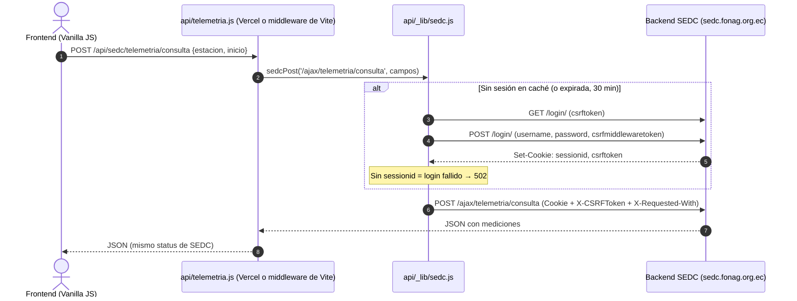

# Arquitectura Técnica y Especificación de Ingeniería: FONAG SEDC

Documentación arquitectónica para desarrolladores sobre la plataforma web del **SEDC (Sistema de Estandarización de Datos Crudos Hidroclimáticos del FONAG - Fondo para la Protección del Agua)**. Todo lo descrito aquí corresponde al código actual del repositorio.

---

## 1. Visión General y Principios Arquitectónicos

La aplicación es un **portal web Multi-Page (MPA) en Vanilla JavaScript**, concebido como interfaz de consulta hidroclimática, telemetría y anuarios estadísticos de las cuencas que abastecen de agua al Distrito Metropolitano de Quito (DMQ).

### 1.1. Principios Fundamentales
1. **Separación de responsabilidades**: servicios de datos (`src/js/services/`), componentes reutilizables (átomos, moléculas, organismos) y controladores por página (`src/js/pages/`).
2. **Sin frameworks de UI**: sin jQuery, Bootstrap ni virtual DOM (React, Vue, Angular). El DOM se manipula directamente.
3. **Arquitectura Multi-Page (MPA)**: cada URL tiene su propio `index.html` como entrada de Vite (`/`, `/estaciones/`, `/consultas/periodo/`, `/consultas/anuario/`, `/tiempo-real/`, `/contacto/`).
4. **Datos 100% SEDC, sin respaldos**: todo dato mostrado o descargado proviene en vivo de la API autenticada del SEDC. No existen datasets locales de respaldo ni datos simulados: si la API falla, la página muestra el mensaje compartido "Error en el API, intenta más tarde." (`src/js/atoms/api-error.js`).

### 1.2. Tech Stack

| Capa / Categoría | Tecnología / Librería | Versión (`package.json`) | Propósito |
|---|---|---|---|
| **Core Client** | Vanilla JavaScript (ES Modules) | — | Lógica de cliente sin virtual DOM. |
| **Markup** | HTML5 + WAI-ARIA | — | Landmarks, migas de pan y modales con atributos ARIA (ver sección 3). |
| **Bundler & Dev Server** | Vite | `^6.2.0` | Build MPA, HMR y middleware de desarrollo para `/api/sedc/*`. |
| **CSS** | CSS nativo con tokens + Tailwind CSS v4 (`@tailwindcss/vite`) | `^4.0.9` | Tokens en `:root` (`src/css/tokens/`) y puente `@theme` de Tailwind en `src/css/main.css`. |
| **Cartografía** | Leaflet | `^1.9.4` | Polígonos GeoJSON de los Ejes de Trabajo y marcadores de estaciones. |
| **Visualización principal** | Plotly (`plotly.js-dist-min`) | `^4.1.1` | Figuras de SEDC (periodo, anuario) y figura de telemetría; carga diferida con `src/js/atoms/plotly-loader.js`. |
| **Visualización de respaldo de render** | Chart.js | `^4.5.1` | Solo dentro de `renderPeriodoChart()` cuando la serie no trae figura Plotly (ver 5.4). No es una fuente de datos alternativa. |
| **Carrusel** | Embla Carousel | `^8.6.0` | Carrusel de socios/constituyentes en la portada. |
| **Calidad** | ESLint + Stylelint (`stylelint-config-standard`) | `^10.10.0` / `^17.15.0` | Lint de JS (`src/js`, `api/`, `scripts/`, `vite.config.js`) y CSS (`src/css`). |
| **Capa API propia** | Vercel Serverless Functions (módulo `https` de Node.js) | — | `api/*.js` + `api/_lib/sedc.js`: login Django (`sessionid` + `csrftoken`) y reenvío a SEDC. Reutilizadas por el middleware de desarrollo. |
| **Despliegue** | Vercel | — | `vercel.json`: rewrites de `/api/sedc/*` y `cleanUrls: true`. |

---

## 2. Estructura del Proyecto

```
./ (raíz del repositorio)
├── index.html                           # Entrada: Portada (mapa de ejes + Cifras del Portal + socios)
├── estaciones/index.html                # Entrada: Catálogo de Estaciones
├── consultas/
│   ├── periodo/index.html               # Entrada: Consultas por Periodo
│   └── anuario/index.html               # Entrada: Anuario Hidroclimático
├── tiempo-real/index.html               # Entrada: Datos en Tiempo Real (telemetría)
├── contacto/index.html                  # Entrada: Formulario de contacto + mapa embebido de la oficina
├── api/                                 # Vercel Serverless Functions (también montadas en desarrollo)
│   ├── _lib/sedc.js                     # getConfig, requestHttps, getSedcSession, sedcGet, sedcPost, parseBody, sendJson, methodGuard
│   ├── estaciones.js                    # GET  → SEDC GET  /estacion/list/
│   ├── variables.js                     # GET  → SEDC GET  /variable/<seccion>/list
│   ├── hydro-annual.js                  # POST → SEDC POST /hydro_annual (JSON o Excel oficial)
│   ├── telemetria.js                    # POST → SEDC POST /ajax/telemetria/consulta
│   ├── alarma-transmision.js            # GET  → SEDC POST /ajax/telemetria/mapa_alarma_transmision
│   └── periodo.js                       # POST → SEDC POST /reportes/consultas_periodo (JSON o archivo oficial)
├── scripts/check-secrets.js             # Detector de credenciales (hook pre-commit y npm run check:secrets)
├── .githooks/pre-commit                 # Ejecuta node scripts/check-secrets.js sobre los cambios en stage
├── openspec/changes/                    # Artefactos SDD de cambios anteriores
├── src/
│   ├── css/
│   │   ├── main.css                     # Entrada CSS: Tailwind, tokens, puente @theme e imports en orden de cascada
│   │   ├── tokens/                      # colors.css, typography.css, spacing.css, index.css
│   │   ├── atoms/                       # buttons (incl. .btn-limpiar), inputs, badges, social-link, loader, sprites
│   │   ├── molecules/                   # nav-menu, hero-search, stat-card, constituent-item, data-table, search-field, card, custom-datepicker
│   │   ├── organisms/                   # portal-header, hero-portal, stats-section, home-map-section, constituents-carousel,
│   │   │                                #   anuario-view, periodo-view, tiempo-real-view, estaciones-view, header, hero, footer, contacto-view
│   │   └── templates/layout.css         # Grid principal y contenedores
│   ├── data/
│   │   └── ejes_2026.json               # GeoJSON de los 9 Ejes de Trabajo (geografía estática, no respaldo)
│   ├── images/                          # Imágenes y sprites (.webp)
│   └── js/
│       ├── main.js                      # Controller de la Portada
│       ├── atoms/
│       │   ├── api-error.js             # API_ERROR_MESSAGE, apiErrorHtml(), showApiError()
│       │   ├── escape-html.js           # escapeHtml(), displayValue()
│       │   ├── global-loader.js         # initGlobalHttpLoader(), showInlineLoader(), showGlobalLoader(), hideGlobalLoader()
│       │   ├── plotly-loader.js         # loadPlotly() (import diferido), normalizeSedcTraces()
│       │   └── button.js                # initButtons() (efecto ripple, portada)
│       ├── molecules/
│       │   ├── charts/
│       │   │   ├── periodo-charts.js    # renderPeriodoChart(), destroyPeriodoChart(), showPeriodoChartLoader(), buildStationChartTitle()
│       │   │   ├── anuario-sedc.js      # renderAnuarioSedc(), destroyAnuarioSedc() (tablas y figuras de /hydro_annual)
│       │   │   └── telemetria-figure.js # buildTelemetriaFigure() (figura Plotly al estilo de Django)
│       │   ├── data-table/column-filter.js  # initColumnFilter(): columnas visibles de la tabla de estaciones
│       │   ├── datepicker/custom-datepicker.js # initCustomDatePickers(), attachCustomDatePicker()
│       │   └── map/leaflet-map.js       # initLeafletMap(), EJES_CONFIG, TYPE_COLORS, getEjeConfig(), formatEjeName()
│       ├── organisms/
│       │   ├── home-map.js              # initHomeStationsMap(): mapa y tarjeta de ejes de la portada
│       │   ├── portal-stats.js          # initPortalStats(): Cifras del Portal calculadas con la API
│       │   ├── portal-header.js         # initPortalHeader(): navegación global
│       │   ├── theme-toggle.js          # initThemeToggle(): fuerza el tema claro
│       │   └── constituents-carousel.js # initConstituentsCarousel() (Embla)
│       ├── services/
│       │   ├── estaciones-service.js    # fetchEstaciones(), normalizeEstaciones()
│       │   ├── periodo-service.js       # loadVariables(), loadEstacionesPorVariable(), fetchSeriesDeTiempo(),
│       │   │                            #   downloadPeriodoExport(), exportarSerieCsv()
│       │   ├── anuario-service.js       # fetchAnuarioSedc(), downloadAnuarioExcel()
│       │   └── telemetria-service.js    # fetchTelemetriaReal(), fetchEstadoTransmision()
│       └── pages/                       # Controllers por entrada MPA
│           ├── estaciones.js
│           ├── periodo.js
│           ├── anuario.js
│           ├── tiempo-real.js
│           └── contacto.js
├── vite.config.js                       # Entradas MPA, puerto 9000 y middleware de desarrollo que ejecuta api/*.js
├── vercel.json                          # Rewrites /api/sedc/* → api/* y cleanUrls
├── eslint.config.js                     # ESLint (globals de navegador y Node declarados explícitamente)
├── .stylelintrc.json                    # Stylelint (stylelint-config-standard con reglas relajadas)
├── .env.example                         # Plantilla: SEDC_API_BASE_URL, SEDC_USERNAME, SEDC_PASSWORD
└── package.json                         # Scripts y dependencias
```

No existen `src/js/services/sedc-api.js`, `fetchWithAuth`, `mockSeries`, `src/data/estaciones.json` ni un motor genérico de tablas (`table-core.js`, `table-renderer.js`).

---

## 3. HTML Semántico y Accesibilidad (a11y)

Estado actual verificado en los `index.html` y controladores:

1. **Encabezados**:
   - Estaciones, Periodo, Anuario y Tiempo Real tienen un único `<h1>` ("Red de Monitoreo Hidrometeorológico FONAG", "Consultas por periodo", "Anuario Hidroclimático", "Datos en Tiempo Real").
   - La Portada (`index.html`) y Contacto (`contacto/index.html`) **no** tienen `<h1>` actualmente (la portada empieza en `<h2>`). Al crear o modificar vistas, incluye un único `<h1>`.
2. **Landmarks**: todas las páginas usan `<header class="portal-header">`, `<nav aria-label="Navegación principal">`, `<main>` y `<footer>`. Las vistas de consulta añaden `<nav aria-label="Migas de pan">`.
3. **Formularios**:
   - En Estaciones, Periodo, Anuario y Tiempo Real los filtros tienen `<label for="...">`.
   - El formulario de Contacto usa solo `placeholder` (sin `<label>`); es una deuda de accesibilidad conocida.
4. **Modales** (Periodo, Anuario y Tiempo Real): `role="dialog"`, `aria-modal="true"`, `aria-labelledby` y cierre con la tecla `Escape` y con un botón `aria-label="Cerrar modal"`. **No** hay gestión de foco (no se mueve el foco al abrir ni se atrapa dentro del modal). Estaciones no tiene modal.
5. El botón de menú móvil usa `aria-expanded` y `aria-controls`; el estado de error de la API usa `role="alert"`.

---

## 4. Arquitectura CSS: Tokens y Atomic Design

### 4.1. Design Tokens (`src/css/tokens/`)
Los tokens se declaran en `:root` y se agregan en `tokens/index.css`:

```css
/* Extracto real de src/css/tokens/ (colors.css, spacing.css, typography.css) */
:root {
  /* Matriz oficial de color (--palette-r{fila}-c{columna}) y alias semánticos */
  --palette-r1-c3: #242857;
  --palette-r1-c4: #41a6e5;
  --palette-r1-c6: #f19001;
  --color-palette-navy: var(--palette-r1-c3);
  --color-palette-blue: var(--palette-r1-c4);
  --color-palette-orange: var(--palette-r1-c6);
  --color-brand-primary: var(--color-palette-navy);
  --color-brand-orange: var(--color-palette-orange);
  --color-brand-orange-hover: #d97d00;

  /* Tipografía */
  --font-family-sans: 'Inter', system-ui, -apple-system, BlinkMacSystemFont, 'Segoe UI', Roboto, Oxygen, Ubuntu, Cantarell, sans-serif;

  /* Espaciado (base 4px) */
  --space-1: 0.25rem;
  --space-2: 0.5rem;
  --space-4: 1rem;
  --space-8: 2rem;

  /* Radios */
  --radius-md: 0.5rem;
  --radius-12: 0.75rem;
  --radius-18: 1.125rem;
  --radius-full: 9999px;
}
```

Otros grupos disponibles: `--font-size-*`, `--font-weight-*`, `--line-height-*`, `--shadow-*`, `--transition-*`, `--radius-xs|sm|lg|xl|2xl`, `--bg-*`, `--text-primary`, `--color-footer-*`.

**Uso real de los tokens**: los tokens son la referencia del sistema visual, pero el CSS de átomos, moléculas y organismos todavía contiene muchos colores hex escritos directamente (unos 500, por ejemplo `.btn-limpiar` en `atoms/buttons.css`), igual que algunos controladores JS (colores de `EJES_CONFIG`, `TYPE_COLORS` y de las series). El código nuevo debe usar los tokens; no se debe asumir que el proyecto está libre de hex.

### 4.2. Estructura Atómica
- **Átomos (`src/css/atoms/`)**: botones (`.btn`, `.btn-limpiar`), inputs, badges, loader y estado de error (`loader.css`), sprites.
- **Moléculas (`src/css/molecules/`)**: `nav-menu`, `stat-card`, `data-table`, `custom-datepicker`, `card`, etc.
- **Organismos (`src/css/organisms/`)**: `portal-header`, `home-map-section`, vistas por página (`periodo-view`, `anuario-view`, `tiempo-real-view`, `estaciones-view`, `contacto-view`), `footer`.
- **Registro**: todo archivo `.css` nuevo se importa en `src/css/main.css` respetando el orden tokens → átomos → moléculas → organismos → templates.

### 4.3. Tema
`initThemeToggle()` (`src/js/organisms/theme-toggle.js`) elimina el atributo `data-theme` del `<html>` y la clave `fonag-theme` de `localStorage`. El portal usa solo el tema claro; no hay selector de tema ni modo oscuro.

---

## 5. Paradigmas JavaScript

### 5.1. Estado por página y filtros con funciones puras
Cada controlador de página mantiene su estado en variables locales del módulo (por ejemplo `allEstaciones`, `activeEje`) y filtra con `Array.prototype.filter`:

```javascript
// Extracto simplificado de src/js/pages/periodo.js
const filtered = allEstaciones.filter((est) => {
  const matchMapEje = (activeEje === 'ALL') ||
    (est.eje_trabajo && est.eje_trabajo.toUpperCase() === activeEje.toUpperCase());
  // ...más condiciones: variable (point_geojson), tipo, código, nombre, eje del select, periodo
  return matchMapEje /* && ... */;
});
```

### 5.2. Eje de trabajo
El eje de cada estación es `eje_trabajo` tal como lo devuelve `/estacion/list/` (sesión autenticada). **No se calcula en el cliente** (no hay intersección punto-polígono); `normalizeEstaciones()` solo lo recorta. Las páginas Anuario y Tiempo Real lo copian como `ejeCalculado`, que es un alias del mismo valor.

`src/data/ejes_2026.json` contiene los polígonos de los **9 Ejes de Trabajo**: Antisana, Papallacta - Oyacachi, Pichincha Atacazo, Pita, San Pedro, Pisque, Norcentral, Noroccidente y Nororiente DMQ. Los mismos 9 ejes (con colores) están en `EJES_CONFIG` de `src/js/molecules/map/leaflet-map.js`, fuente única también para el mapa de la portada.

### 5.3. Tablas y exportación
No existe un motor genérico de tablas; cada vista resuelve sus tablas:

| Vista | Tabla | Descarga |
|---|---|---|
| Estaciones (`pages/estaciones.js`) | Filtrado, orden y paginación en el controlador; columnas visibles con `initColumnFilter()` | CSV generado en el cliente con todas las estaciones recibidas de la API (`estaciones_fonag.csv`) |
| Periodo (`pages/periodo.js`) | Vista previa de puntos en el modal | Archivo **oficial** de SEDC con `downloadPeriodoExport()` (CSV para subhorario validado, Excel para el resto); si falla, `alert(API_ERROR_MESSAGE)` |
| Anuario (`pages/anuario.js` + `anuario-sedc.js`) | Tablas mensuales construidas con la respuesta de `/hydro_annual` | Excel **oficial** de SEDC con `downloadAnuarioExcel()` (una estación o "compilado" de las estaciones filtradas); si falla, `alert(API_ERROR_MESSAGE)` |
| Tiempo Real (`pages/tiempo-real.js`) | Vista previa de lecturas de la variable seleccionada | SEDC no exporta telemetría: `exportarSerieCsv()` (en `periodo-service.js`) genera en el cliente un CSV con las lecturas reales recibidas |

Los botones de descarga de los modales se renderizan con `hidden` cuando no hay datos (Periodo, Anuario y Tiempo Real).

### 5.4. Gráficos
1. **Plotly (principal)**: Periodo usa la figura `grafico` que devuelve SEDC (también la rosa de vientos `barpolar`); Anuario usa las figuras `graph` de `/hydro_annual`; Tiempo Real construye la figura con `buildTelemetriaFigure()` replicando la de Django (umbrales y viento). `normalizeSedcTraces()` corrige los colores hex sin `#` que envía SEDC.
2. **Chart.js**: `renderPeriodoChart()` (compartido por Periodo y Tiempo Real) dibuja con Chart.js solo si la serie no trae `series.figure` (en la práctica, cuando `buildTelemetriaFigure()` devuelve `null` porque el ítem no trae `datos`).
3. **Título estándar**: `buildStationChartTitle(estacion)` produce "Estación {código} {nombre}" (escapado) para Periodo y Tiempo Real; Tiempo Real añade el subtítulo "Eje: … • Periodo: …".
4. Antes de dibujar se destruye la instancia previa (`destroyPeriodoChart()` / `destroyAnuarioSedc()`).

### 5.5. Inserción segura en el DOM
Todo string de la API pasa por `escapeHtml()` o `displayValue()` (`src/js/atoms/escape-html.js`) antes de `innerHTML` (tarjetas, opciones de selects, cabeceras de modales, filas de tablas, popups de mapas, títulos de gráficos). `displayValue()` devuelve `-` cuando el dato falta. Los encabezados de tablas del anuario conservan solo los `<br>` que envía SEDC.

### 5.6. Convenciones de UI compartidas
- **Botón "Limpiar"**: clase `.btn-limpiar` (`src/css/atoms/buttons.css`), usada en Estaciones, Periodo, Anuario y Tiempo Real.
- **Select "Eje de trabajo" ↔ polígonos del mapa**: en Anuario y Tiempo Real el select y el clic en un polígono comparten `activeEje` (`onEjeSelect` de `initLeafletMap()` actualiza el select; el `change` del select llama a `mapController.setEje()`). En Periodo el select de eje es un filtro independiente que se combina con el eje elegido en el mapa; "Limpiar" restablece ambos.
- **Loader global**: `initGlobalHttpLoader()` envuelve `window.fetch` y muestra la barra de progreso y la tarjeta "Consultando servidor..." en peticiones a `/api/`, URLs absolutas o `.json`. `showInlineLoader(container)` muestra la misma tarjeta dentro de un contenedor y devuelve la función que la retira.
- **Estado de transmisión** (Tiempo Real): `fetchEstadoTransmision()` colorea la tarjeta "Último Dato" según NORMAL / EXPECTANTE / FALLO calculado por SEDC; si falla, la tarjeta queda neutra.

---

## 6. Arquitectura de Integración API (Vercel Functions + middleware de desarrollo)

El cliente solo llama a rutas `/api/sedc/*` del mismo origen. Una única implementación en `api/` atiende esas rutas en ambos entornos:

- **Producción (Vercel)**: `vercel.json` reescribe cada ruta a su función: `/api/sedc/estacion/list[/]` → `/api/estaciones`, `/api/sedc/variable/:seccion/list` → `/api/variables?seccion=:seccion`, `/api/sedc/hydro_annual` → `/api/hydro-annual`, `/api/sedc/telemetria/consulta` → `/api/telemetria`, `/api/sedc/telemetria/alarma_transmision` → `/api/alarma-transmision`, `/api/sedc/reportes/consultas_periodo` → `/api/periodo`. `/api/sedc/point_geojson` se reescribe directamente a `https://sedc.fonag.org.ec/point_geojson` (pública).
- **Desarrollo (`npm run dev`)**: `vite.config.js` monta un middleware en `/api/sedc` con la tabla `SEDC_ROUTES` (regex → handler de `api/*.js`). Adapta `req`/`res` al formato de Vercel (`res.status()`, `res.json()`, `res.send()`, `req.query`, `req.body` como texto) y reenvía `point_geojson` a SEDC. Cualquier otra ruta `/api/sedc/*` responde `404`, como en producción. Las variables `SEDC_*` de `.env` se cargan con `loadEnv()` y se copian a `process.env`, que es lo que lee `api/_lib/sedc.js`; si faltan credenciales se muestra una advertencia en consola al arrancar.

### 6.1. Diagrama de Secuencia (ejemplo: telemetría)



Secuencia en texto:

1. El frontend envía `POST /api/sedc/telemetria/consulta` con `{ estacion, inicio }`.
2. La función `api/telemetria.js` (en Vercel o en el middleware de Vite) llama a `sedcPost('/ajax/telemetria/consulta', campos)` de `api/_lib/sedc.js`.
3. Si no hay sesión en caché o expiró (30 minutos), `getSedcSession()` hace `GET /login/` para obtener `csrftoken`.
4. Luego hace `POST /login/` con `username`, `password` y `csrfmiddlewaretoken`.
5. SEDC responde con las cookies `sessionid` y `csrftoken`. Si no llega `sessionid`, el login falló y la función responde `502`.
6. Con la sesión, `sedcPost` envía `POST /ajax/telemetria/consulta` con `Cookie`, `X-CSRFToken` y `X-Requested-With`.
7. SEDC devuelve el JSON con las mediciones.
8. La función reenvía al cliente el JSON con el mismo código de estado de SEDC.

### 6.2. Seguridad de Credenciales y Entorno
1. **Solo variables de entorno**: `SEDC_USERNAME` y `SEDC_PASSWORD` vienen de `.env` en desarrollo y de las Environment Variables de Vercel en producción; no tienen valores por defecto. `SEDC_API_BASE_URL` es opcional (por defecto `https://sedc.fonag.org.ec`). `getConfig()` elimina comillas y espacios de los valores.
2. **Sin credenciales**: `sendJson()` responde `502` con un mensaje que indica qué variable falta; en el cliente el `fetch` no es `ok`, el servicio lanza un error y la página muestra el error compartido.
3. **Sin prefijo `VITE_`**: las credenciales nunca se empaquetan en el cliente; solo existen en el runtime de Node.js.
4. **Logs**: se registran errores de conexión y de login (sin cookies, tokens ni cuerpos de respuesta).
5. **Sin CORS**: las funciones no envían `Access-Control-Allow-Origin`; el portal las llama desde el mismo origen.
6. **Validación de entrada**: `variables.js` solo acepta `seccion` con letras y `_` (si no, `400`; por defecto `hidro`); `estaciones.js` solo reenvía parámetros permitidos; métodos distintos al esperado responden `405` (`methodGuard`).
7. **Hook pre-commit**: `.githooks/pre-commit` ejecuta `node scripts/check-secrets.js` (activado por `npm install` vía el script `prepare`). Detecta variables `SEDC_*` con valor por defecto escrito, contraseñas/tokens literales y URLs con usuario y clave; permite placeholders como `tu_usuario`.

### 6.3. Catálogo de Servicios SEDC Integrados

| Ruta del cliente | Función | Endpoint SEDC | Respuesta |
|---|---|---|---|
| `GET /api/sedc/estacion/list/` | `api/estaciones.js` | `GET /estacion/list/` | JSON (lista de estaciones; por defecto `administrador=1`, `limit=300`) |
| `GET /api/sedc/variable/<seccion>/list` | `api/variables.js` | `GET /variable/<seccion>/list` | JSON (catálogo de variables) |
| `GET /api/sedc/point_geojson` | rewrite directo (pública) | `GET /point_geojson` | GeoJSON (estaciones que miden una variable) |
| `POST /api/sedc/hydro_annual` | `api/hydro-annual.js` | `POST /hydro_annual` | JSON (tablas + figuras) o Excel oficial (`export: true`) |
| `POST /api/sedc/telemetria/consulta` | `api/telemetria.js` | `POST /ajax/telemetria/consulta` | JSON (solo acepta `inicio`, sin fecha fin) |
| `GET /api/sedc/telemetria/alarma_transmision` | `api/alarma-transmision.js` | `POST /ajax/telemetria/mapa_alarma_transmision` | JSON (`estaciones` GeoJSON con `estado` NORMAL / EXPECTANTE / FALLO, `limites`) |
| `POST /api/sedc/reportes/consultas_periodo` | `api/periodo.js` | `POST /reportes/consultas_periodo` | JSON (figura Plotly) o archivo oficial (`export: true`) |

En las exportaciones la función omite `X-Requested-With` y devuelve el archivo con el `content-type` y `content-disposition` de Django.

---

## 7. Manejo de Errores de la API (sin respaldos)

Todo dato proviene del SEDC. Cuando el backend no responde o la sesión no está autenticada, la aplicación **no** sustituye los datos: informa el error.

1. **Estado de error compartido** (`src/js/atoms/api-error.js`): `API_ERROR_MESSAGE` = "Error en el API, intenta más tarde."; `showApiError(container)` reemplaza el contenido del contenedor con `apiErrorHtml()` (`role="alert"`).
2. **Comportamiento de los servicios**:
   - `fetchEstaciones()` lanza un error si la respuesta no es `ok` o si SEDC devuelve el listado sin sesión autenticada (primera fila sin `eje_trabajo`). `normalizeEstaciones()` conserva solo estaciones de administrador FONAG activas y guarda la fila original en `raw`.
   - `loadVariables()` y `loadEstacionesPorVariable()` lanzan un error si la API falla.
   - `fetchSeriesDeTiempo()` lanza un error ante fallos de red/HTTP o parámetros incompletos; devuelve `[]` cuando SEDC responde sin registros.
   - `fetchAnuarioSedc()` / `downloadAnuarioExcel()` lanzan un error si `POST /hydro_annual` no responde `ok`.
   - `fetchTelemetriaReal()` no lanza: devuelve `hasData: false` con `apiError: true` cuando la API falló, o con un mensaje cuando no hay lecturas.
   - `fetchEstadoTransmision()` lanza un error; Tiempo Real lo captura y deja la tarjeta "Último Dato" neutra.
   - Si falla una descarga oficial (Periodo o Anuario) se muestra `alert(API_ERROR_MESSAGE)`; no hay archivo sustituto.
3. **Datos faltantes**: se muestran como `-` (`displayValue()`) o celda vacía en CSV; nunca se rellenan con valores por defecto. Los contadores del HTML arrancan en `-` y se llenan con la API.
4. **Valores derivados de la API**: las "Cifras del Portal" (estaciones, estaciones con telemetría, variables, año inicial), los años del selector del anuario (del año actual al `est_fecha_inicio` más antiguo) y los conteos por tipo/eje se calculan con los datos recibidos.
5. **Único dato local**: `src/data/ejes_2026.json` (polígonos de los Ejes de Trabajo), usado por `leaflet-map.js` y `home-map.js`.

---

## 8. Metodología de Desarrollo: Spec-Driven Development (SDD)

El proyecto usa **Spec-Driven Development (SDD)** para cambios complejos. `openspec/changes/` contiene los artefactos de cambios anteriores (`init-app`, `portal-components`, `constituents-carousel`, `footer-component`); no todos los cambios recientes tienen artefactos ahí.

Flujo recomendado:
- `sdd-explore`: análisis del código base y requerimientos.
- `sdd-propose` / `sdd-spec` / `sdd-design`: definición del cambio.
- `sdd-apply`: implementación.
- `sdd-verify`: validación en navegador, `npm run lint` y `npm run build`.

El repositorio no tiene pruebas automatizadas ni un script `test`.

---

## 9. Scripts de Compilación y Calidad

Comandos definidos en `package.json`:

- `npm run dev`: servidor de desarrollo Vite en `http://localhost:9000/` (`server.port: 9000`) con el middleware SEDC.
- `npm run build`: compilación de producción de la MPA en `dist/`.
- `npm run preview`: sirve la build de producción localmente.
- `npm run lint`: ejecuta `lint:css` y luego `lint:js`.
- `npm run lint:css`: Stylelint sobre `src/css/**/*.css`.
- `npm run lint:js`: ESLint sobre `src/js`, `api/`, `scripts/` y `vite.config.js`.
- `npm run check:secrets`: `node scripts/check-secrets.js --all` (revisa todos los archivos versionados).
- `prepare` (automático en `npm install`): `git config core.hooksPath .githooks`.

---

## 10. Repositorio Git

### 10.1. Identificación
- **Nombre**: `fonag`
- **Remoto `origin` (SSH)**: `git@github.com:webmasterft/fonag.git`
- **Equivalente HTTPS**: `https://github.com/webmasterft/fonag.git`
- **Rama principal**: `main`

### 10.2. Convenciones
1. **Conventional Commits**: `feat: ...`, `fix: ...`, `docs: ...`, `style: ...`, `refactor: ...`, `perf: ...`, `chore: ...` (se admite scope, p. ej. `fix(tiempo-real): ...`). Algunos commits antiguos no siguen el formato; los nuevos deben seguirlo.
2. **Sin atribución de IA**: no se añaden pies de página tipo `Co-Authored-By` ni firmas automáticas en los commits.
3. **Antes de integrar**: `npm run lint` y `npm run build` sin errores; el hook pre-commit bloquea credenciales escritas en el código.
